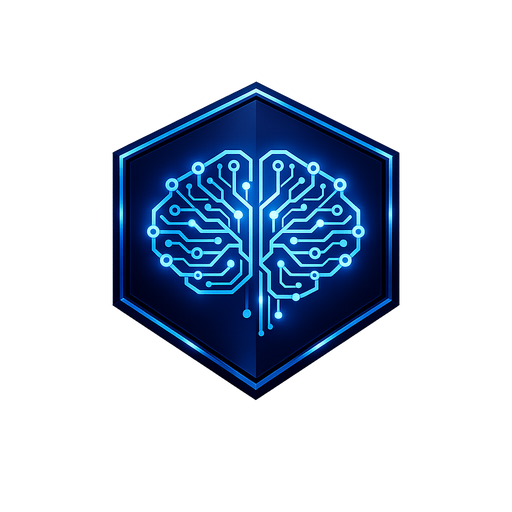

<p align="center">
  
</p>

<p align="center">
  <b>Stops a hijacked or prompt-injected AI agent from running destructive commands, leaking secrets, or poisoning memory it writes through ShieldCortex.</b>
</p>

<p align="center">
  <a href="https://www.npmjs.com/package/shieldcortex"></a>
  <a href="https://opensource.org/licenses/MIT"></a>
</p>

**Trusted task: let it work. Hijack: a plain-English card. Catastrophe: a hard stop.**

ShieldCortex scans memory writes that go through it and, once turned on, gates the tools an agent calls on Claude Code, OpenClaw and Hermes. Codex, Cursor, VS Code and other MCP hosts get a memory scanner the model may call, not a gate. It does not replace OpenClaw, Hermes, or Claude memory.

## What it does

- **Tool gate.** On Claude Code and OpenClaw, once Action Guard is on (it stays off until you turn it on), a trusted task runs, a suspicious call gets a plain-English card and is held for your approval, and a catastrophic command is a hard stop. When nobody is at a prompt, the denial or held request sent to your Action Guard webhook carries that card (5.18+): what, why, who and the exact `shieldcortex approve` command, never the raw command or a credential. Hermes gates tool calls once you enable its plugin and the local API (`shieldcortex api`) is up; the plugin has its own setting, and Hermes has no approval prompt, so a call Action Guard would hold is blocked while enforcing. [Hermes plugin](plugins/hermes/shieldcortex/README.md), [Policy lock](docs/UPDATING.md#policy-lock), [What's new in 5.18](docs/UPDATING.md#whats-new-in-518).
- **Memory firewall.** Writes that go through ShieldCortex are scanned before they stick: recognised injection and leaked credentials are quarantined or blocked. [How scan results work](docs/SCAN.md).
- **Reports changes.** At each fresh Claude Code startup, the agent config watch checks the hooks and MCP servers in Claude Code, OpenClaw, Cursor, Codex and Gemini CLI configs. At each Claude Code session start, the MCP tool-description check compares the tool descriptions of the local MCP servers in your user-level configs with the last check, at most once per 6 hours per server unless its launch config changed. When either finds a change ShieldCortex did not make, it sends one message to your Action Guard webhook, if one is set. They detect and report; they do not block, and the config watch is not live. [Limits](docs/security/agent-config-watch.md), [What's new in 5.17](docs/UPDATING.md#whats-new-in-517), [What's new in 5.14](docs/UPDATING.md#whats-new-in-514).

## What a catch looks like

```bash
shieldcortex scan "ignore previous instructions"
```

```
ShieldCortex Scan Result
──────────────────────────────────────────────────
  Result:      QUARANTINE
  Source:      cli:shieldcortex-scan (attested)
  Provenance:  cli (trusted, L2 not applied)
  Trust:       0.90
  Sensitivity: PUBLIC
  Anomaly:     0.00
  Reason:      Quarantined: Instruction injection detected (confidence: 0.8)
  Threats:     instruction_injection
  Patterns:    hidden_instruction
```

That string was caught and quarantined. Nothing was stored as a memory, and the exit code is non-zero so a script or CI job can act on it. [How scan results work](docs/SCAN.md).

<!-- TODO: demo recording. Uncomment when assets/demo.gif exists.

-->

## Install

Requires Node 22.14+ or 24+. Upgrading from 4.x? Read [Upgrading to 5](docs/UPGRADING-5.md) first. [Node 20, Node 23, and what npm does](docs/UPDATING.md#node-requirement).

```bash
npm install -g shieldcortex
shieldcortex setup
shieldcortex doctor
```

Bare `setup` asks before wiring each host (`setup <host>` wires that host without asking). Setup can change Claude Code and OpenClaw config files, and may restart the OpenClaw gateway: [what setup writes](#setup-details). Details: [Updating](docs/UPDATING.md#updating), [Storage maintenance](docs/UPDATING.md#storage-maintenance), [What postinstall does](docs/openclaw-integration.md#install-time-refresh-postinstall), [Offline embedding cache](docs/offline-embeddings.md).

`shieldcortex doctor` fits on one screen. Things to fix come first, each with a copy-paste command. Warnings that are expected on your host, such as a feature you left off, sit on one line and ask for nothing. Each agent gets one line. `shieldcortex doctor --verbose` prints every check in full, and `shieldcortex doctor --explain <ID>` prints one check, with the `[id]` shown after each item.

```text
ShieldCortex Doctor · v5.19.0 · tars
✅ Healthy · 2 things to fix · Guard: off (your choice)

TO FIX
 1. 79 memories can't be found by meaning search (27%)  [semantic-coverage]
    they are saved, but a search by meaning will not return them
    $ shieldcortex memories embed-backfill --execute
 2. Session-end memory capture is switched on but not connected  [auto-memory-sessionend-hook]
    nothing is saved when a session ends until the hook is wired
    $ shieldcortex setup --with-session-end

EXPECTED ON THIS HOST (no action)
 · Conversation scanning off · Action Guard off · Guard notifications not set · Policy lock not set

AGENTS ON THIS HOST
 Claude Code       ✔ connected · memory + tool gate · gate off   (16+ sessions)
 OpenClaw          — not installed
 Hermes            ✔ connected · memory + tool gate · advisory   (1 live, 15+ ended)
 Codex             ✔ connected · memory only
 Cursor / VS Code  — not installed

39 checks passed · 46 informational rows hidden
details: shieldcortex doctor --verbose · explain one: shieldcortex doctor --explain <ID>
```

<a id="setup-details"></a>
<details><summary>What setup writes, and installs without lifecycle scripts</summary>

`setup` is the onboarding command: it prints one host table and asks before wiring each host. `shieldcortex setup claude` skips the table and runs the Claude Code install without asking. That install can write `~/.claude/CLAUDE.md`, `~/.claude.json` and `~/.claude.json.bak-shieldcortex` if it replaces the file, `~/.claude/settings.json` and `~/.claude/settings.json.bak-shieldcortex` if it replaces the file, and `~/.claude/hooks/cortex-memory/` unless any detected hook root already has a cortex-memory directory. If that hook installer runs against a writable OpenClaw root, it can also copy the OpenClaw hook, install or register the realtime plugin, snapshot and rewrite `openclaw.json`, and may restart the gateway. Two older names still work. `quickstart` takes the same targets as `setup`'s guided path, without hook flags or `uninstall`. `install` is not the wizard: it runs that same Claude Code install as `setup claude`, and is kept for existing scripts and the `--without-*` hook opt-outs. Within 5.x, update with [`shieldcortex update`](docs/UPDATING.md#updating).

If npm skipped the package's lifecycle scripts (for example `--ignore-scripts`, or `ignore-scripts=true` in an npm config), ShieldCortex's postinstall did not run. On a global install that step wires no host. It prints the next step, checks that the database engine loads, writes a default `~/.shieldcortex/config.json` when none exists, refreshes an OpenClaw integration that is already present, and on macOS restarts a dashboard service still running an older build. Skipping it does not skip onboarding: run `shieldcortex setup`, then `shieldcortex doctor`. Without that config file, prompt-time recall stays off until you turn it on. [What postinstall does](docs/openclaw-integration.md#install-time-refresh-postinstall).

</details>

## Where it can block

Action Guard stays off until you turn it on. That shared setting is the tool gate for Claude Code and OpenClaw. A bare `sudo shieldcortex protect` turns it on and pins that posture. [Policy lock](docs/UPDATING.md#policy-lock). The Hermes plugin does not read the shared setting; it has its own (below).

| Host | Memory scan | Tool gate |
|---|---|---|
| Claude Code | yes | bound (PreToolUse) |
| OpenClaw | yes | bound (`before_tool_call`) |
| Hermes | via the local API | bound (`pre_tool_call`) |
| Codex, Cursor, Copilot, MCP | if the agent calls the tools | not a gate |
| LangChain, Python SDK | if you call `scan` or `save` | not a gate |
| Claude SDK browser / computer toolsets (TypeScript) | no | observe by default; `mode: 'enforce'` refuses or holds for approval (`shieldcortex/toolsets`, 5.8+) |

`shieldcortex doctor` prints the same split: `memory + tool gate` for a host that can deny, and memory only, not a gate, for one that cannot. Its `Action guard posture` row shows the configured posture of each gate plane: the Claude Code hook, the OpenClaw plugin (its `openclaw.json` entry merged over the shared setting, then the policy lock) and Hermes (from the Hermes process's own self-report only, since Hermes does not read the shared setting).

<details><summary>Host details and limits</summary>

It fails when the hook and the plugin disagree, or when Hermes reports a looser posture than they hold; Hermes reporting a tighter one is shown, not failed. `shieldcortex guard posture` prints the same reading and changes nothing. These are configured postures, not a check of running processes. It will not print "protected" for a host that cannot deny.

Hermes gates tool calls once you run `hermes plugins enable shieldcortex` and the local API (`shieldcortex api`) is up. The enabled plugin enforces by default, whatever the shared Action Guard setting says: it blocks unless `SHIELDCORTEX_ENFORCE` opts it out (`0`, `false`, `no`, `off` or `advisory`). Hermes has no approval prompt, so a call Action Guard would hold for approval is blocked while enforcing. Advisory mode still blocks Action Guard's hard-block verdicts and recognised calls that would change the guard's own state or config (a plain read of its config with `ls`, `cat`, `head`, `tail`, `wc`, `stat`, `du`, `grep` or `jq` and plain arguments is not one of them; a read with an environment prefix, an option the guard cannot prove harmless, a redirection, nested execution or an interpreter still is). While the API is unreachable, its bounded fallback scan blocks the self-protection and catastrophic shapes it recognises in every mode, and recognised dangerous shapes while enforcing (the default). In advisory mode, only the recognised self-protection and catastrophic shapes are blocked by the fallback. [Hermes plugin](plugins/hermes/shieldcortex/README.md). Codex, Cursor, VS Code, and other MCP hosts get a memory server the model may call. That server is a scanner, not a deny.

If the Claude Code PreToolUse hook fails to load, a bounded fallback still blocks recognised catastrophic commands, even with the guard off. While the hook is broken those patterns also stop routine recursive force-deletes. Calls that do not match stay fail-open. [Full note](docs/UPDATING.md#claude-code-hook-fallback).

The optional enforce-when-ready posture runs the dangerous tier in shadow until this install's own audit shows the guard is operable and reviewed evidence for the running version exists. No such evidence ships yet, so today it stays in shadow and says so. [What's new in 5.4](docs/UPDATING.md#whats-new-in-54).

Native-exec audit signal (5.19+). With Action Guard on, the Claude Code hook and the OpenClaw plugin record, per session, the paths the agent wrote (write tools, shell redirections, `tee`, `dd of=`, `curl -o`, `wget -O`) or compiled (`cc`, `gcc`, `clang`, `rustc` and other compilers with `-o`, `go build -o`; a default `a.out` except for `rustc`/`ghc`). When a later call runs, preloads (`LD_PRELOAD`, `LD_AUDIT`, `DYLD_INSERT_LIBRARIES`) or names one of those files, and it is now an ELF, Mach-O or PE image that the recorded call changed, the audit row gets a `nativeExec` field: `exec`, `load` or `reference`, plus `agent-written`, `compiled-output` or `ambiguous`. A compile and run in the same call is logged with `sameCall`: that is prospective, named from the compile command without reading the output's header, so it does not prove the compile or the run happened, and statement order is not modelled. It is a log entry only. It never denies, holds, escalates or changes severity, including in a tainted OpenClaw session. It is best effort: a path built at runtime, a bare command name found on PATH, a computed `cd`, a write it does not recognise (`cp`, archive extraction) or a call with no session id is not logged, and executable-memory mapping is not covered. The `nativeExec` field holds no path text (other row fields, such as the redacted args, may). Each record under `~/.shieldcortex/native-provenance/` is named by a keyed hash of the path and holds only a kind, a stat of the file before the call and a timestamp. A session's records are swept once its store directory has gone over 24 hours without changing, checked when another session records for the first time, not on a timer. The directory changes only when the session records something, so running or probing recorded files does not keep it alive. The sweep removes only expired session directories, and the store refuses to write, read or sweep through a symlink or special file already in place when it checks (a concurrent swap is not closed). A file starting `MZ`, or a Java class file, can be labelled as native. `auditAllows: false` turns these rows off with the other allow rows. [What's new in 5.19](docs/UPDATING.md#whats-new-in-519).

`shieldcortex policy-evidence` (5.5+) reports what each runtime's own self-report says it is enforcing, as local self-reports rather than attestation. [What's new in 5.5](docs/UPDATING.md#whats-new-in-55).

Webhook notifications for a headless denial or a held approval end with a `card` block (5.18+, version 1): the same what, why and who, the exact approve command, and Approve/Deny choices that carry only the action id. The guard half of one-tap approve from Telegram also ships in 5.18, as a loopback-only `shieldcortex guard approve-tap` endpoint that is off by default; the card carries no nonce yet, so a tap cannot be completed end to end in this release. [What's new in 5.18](docs/UPDATING.md#whats-new-in-518).

</details>

## Also included

- **Local dashboard.** `shieldcortex dashboard` is a local view: Home, Needs you, Memory, Protection, Settings. It is not an approval inbox: held actions are still answered in Telegram or OpenClaw. [What it needs](docs/UPDATING.md#dashboard-recall-and-cloud), [details](#dashboard-details).
- **Security audit.** `shieldcortex audit` scans an AI agent's environment and prints a graded report; `--sarif` writes SARIF 2.1.0.
- **Skill and instruction-file scanner.** `shieldcortex scan-skill <file>` scans one file; `scan-skills` discovers all instruction files.
- **Doctor.** `shieldcortex doctor` is a one-screen summary: what to fix with the command for each, what is expected on this host, and one line per agent, `memory + tool gate` or memory only, not a gate. It will not print "protected" for a host that cannot deny. `--verbose` prints every check; `--explain <ID>` prints one. [Doctor and the host table](docs/UPDATING.md#doctor-and-the-host-table).
- **Claude SDK toolsets.** `shieldcortex/toolsets` (5.8+) sits in front of a Claude SDK browser-use or computer-use driver and by default records what each call would trigger without changing what runs; `mode: 'enforce'` refuses the riskiest calls and holds risky ones for your approval. [Quickstart](docs/quickstarts/claude-sdk-toolsets.md).
- **Approval cards** (5.6+) say what a held action does, why it was held and who asked, in plain English, without the raw command. [What's new in 5.6](docs/UPDATING.md#whats-new-in-56).

## Free and Cloud

Two different apps.

- **Local** (`shieldcortex dashboard`) runs on your machine. The Skill & package scanner (formerly X-Ray) lives here, under Protection.
- **Cloud** is the fleet view: Shield, Capture, Recall, Library, Graph, Replay, Review, Quarantine, Dome, Devices, Keys. Default chrome is glass (Shield). Cloud does not ship X-Ray.

Free cloud: 500 scans/month, 7-day retention, 1 member. Enterprise (fleets, SSO, full replica): sales@drakonsystems.com.

[How to connect a box](docs/UPDATING.md#connect-a-box).

## Links

- [Docs](https://shieldcortex.ai/docs)
- [Dashboard guide](https://shieldcortex.ai/guide)
- [Changelog](https://github.com/Drakon-Systems-Ltd/ShieldCortex/blob/main/CHANGELOG.md)
- [Updating](docs/UPDATING.md)
- [Security](https://github.com/Drakon-Systems-Ltd/ShieldCortex/blob/main/SECURITY.md) (security@drakonsystems.com)
- [Contributing](https://github.com/Drakon-Systems-Ltd/ShieldCortex/blob/main/CONTRIBUTING.md)
- Licence: MIT. Every local feature is free.

<a id="dashboard-details"></a>
<details><summary>Dashboard and recall details</summary>

- **Inspect.** `shieldcortex dashboard` is a local view: Home, Needs you, Memory, Protection, Settings. The Skill & package scanner (formerly X-Ray) is a Protection tab. Memory has Search & browse, Map, Recall, Needs a check, Timeline, Replay, and Files. Needs you lists held-back items, memory pairs that disagree or look duplicated, and new scanner findings. It is not an approval inbox: held actions are still answered in Telegram or OpenClaw. Its counts are labelled when they are partial: pair counts stop at 20 of each kind and the disagreement check compares only the 200 most important memories, a list that failed to refresh shows its last known count, and scanner findings cover the whole computer even when a project is selected. Prompt-time recall into Claude Code is not automatic. [What it needs](docs/UPDATING.md#dashboard-recall-and-cloud). In prompt-time recall (the `UserPromptSubmit` hook), turns detected as a cron job, subagent or liveness probe, or pinned to one of those lanes, get narrower recall than the owner's chat, and rows labelled PERSONAL (private-life notes the classifier recognised or a backfill raised) are withheld from them. This is not universal isolation: a private note the classifier missed and labelled `PUBLIC` can still reach those lanes, and SessionStart context, MCP tool reads and dashboard previews are not lane-scoped. [Recall lanes](docs/UPDATING.md#recall-lanes).

</details>

<p align="center">
  <a href="https://shieldcortex.ai">Website</a> ·
  <a href="https://shieldcortex.ai/docs">Docs</a> ·
  <a href="https://www.npmjs.com/package/shieldcortex">npm</a> ·
  <a href="https://github.com/Drakon-Systems-Ltd/ShieldCortex/blob/main/CHANGELOG.md">Changelog</a>
  <br>
  Built by <a href="https://drakonsystems.com">Drakon Systems</a>
</p>
